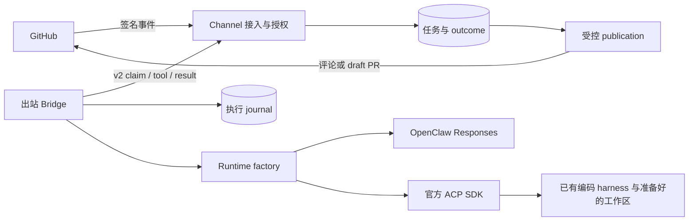

# GitHub Agent Channel v2 架构

Channel 是通用 GitHub 协作通道，Runtime 的模型、编码工具、工作区执行由已有实现承担。OpenClaw 和 ACP 是目前两个适配器，核心不依赖 OpenClaw SDK。部署可使用已有服务或自建服务器，ECS 仅为示例。

## 核心职责

| 层              | 负责                                             | 不承担                     |
| --------------- | ------------------------------------------------ | -------------------------- |
| GitHub 接入     | 签名、source/target、事件与触发规则              | 模型执行                   |
| 任务控制        | scope、actor、assignment、lease、结果/回执持久化 | Runtime 内部推理与工具规划 |
| 出站 bridge     | 本地 journal、适配器选择、结构化结果确认         | GitHub 私钥与任意跨仓写入  |
| Runtime adapter | Provider 协议、生命周期标识与能力限制、产物整理  | 改写仓库/身份授权范围      |
| Publication     | 重新授权、路径/基线策略、评论/Git Data/PR API    | 执行仓库测试、自动 merge   |
| HTTPS edge      | TLS、域名、仅转发 v2 与 webhook 路径             | 长任务处理                 |

## 当前实现选择

GitHub 身份与 API 复用 Octokit；ACP 复用官方 SDK，调用管理员安装的 harness。工作区必须预先准备，Channel 不复制 OpenHands 一类的执行平台。窄范围复用依据见[实现设计](runtime-neutral-design.md)。

任务、outcome、publicationReceipt 分离，目标可为 Issue/PR/仓库；文本只是成果的一部分。任何 GitHub 写入前重新核对 actor 和 binding。PR 默认关闭，启用后固定 baseBranch 和允许文件范围，分支由 task ID 派生。

v2 直接删除旧字段、协议和数据库迁移路径；只接受新格式。云和本地分别持久化网络两端的责任。超时、断线、重启仍保守 unknown；ACP 的 cancel 请求不是已停止证明，不自动恢复或重跑。

## 尚存边界

- 单可信 worker/实例，串行执行；没有多租户、动态多 worker 路由或自动续租。
- OpenClaw 当前仍是读取/分析适配器；ACP 依赖已有 harness 的原生文件/终端工具，未提供客户端 filesystem/terminal 服务。
- ACP 原生进程不是 sandbox；工作区隔离由部署者提供，禁止共享工作区。Docker 自动渲染仅支持 OpenClaw bridge。
- PR 基线在发布前检查并固定 commit parent，但不能原子阻止 GitHub base 在随后推进；分支冲突和不确定写入不自动覆盖/重放。
- 本地协议/SDK 验收与真实环境分开记录；当前已验证 OpenCode 1.3.17 的 [Issue→代码→PR 闭环](acp-live-validation-20261124.md)，不代表所有 ACP harness 已互通。

文件职责、状态与证据分别见[实现地图](implementation-map.md)、[能力台账](capabilities.md)、[验证记录](runtime-neutral-validation-20261122.md)。
