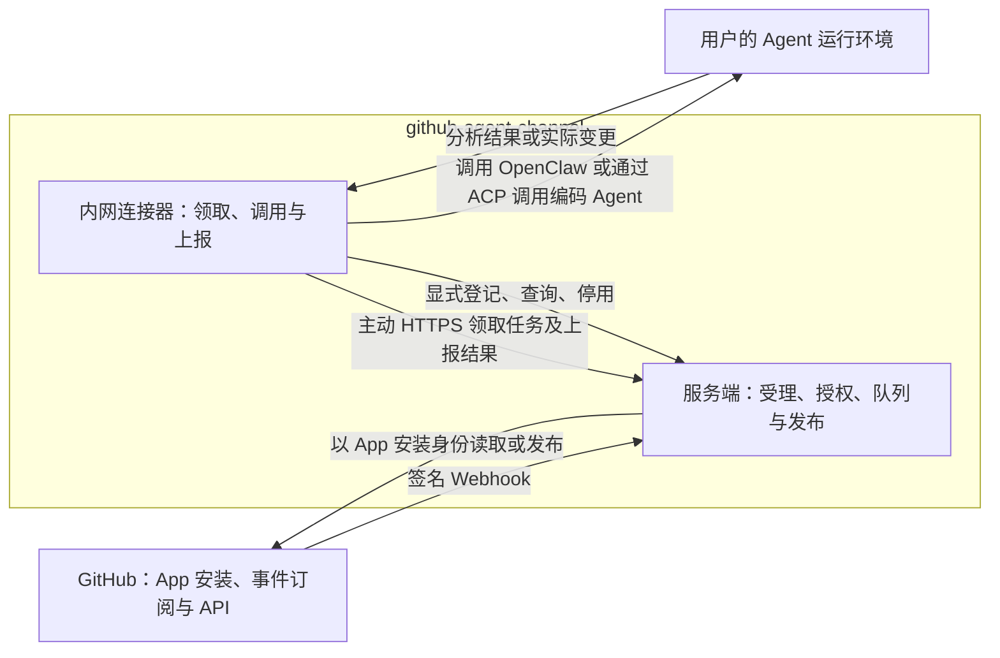
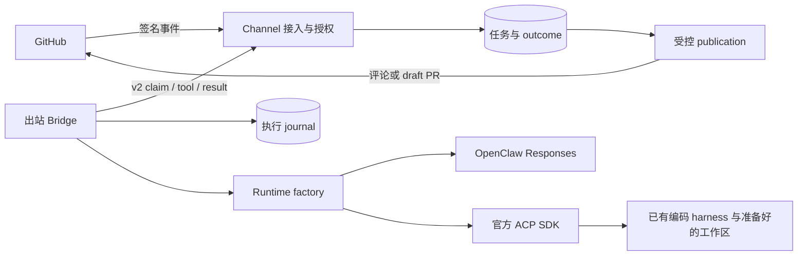

# GitHub Agent Channel v2 架构

**`github-agent-channel` 包含服务端和内网连接器。** GitHub App（例如 `xallor-robot`）是它在 GitHub 上的身份；执行任务的是用户自己的 Agent。ECS 只是服务端的一种部署方式。

管理员在私网签发一次性邀请，设备配对后按[自助接入指南](agent-self-service.md)登记。任务随连接器的领取响应返回，内网 Agent 无需公网入站地址。

| 角色 | 职责与边界 |
| --- | --- |
| GitHub App / 安装 | 定义订阅的事件和所需权限，由安装者授予仓库范围。GitHub 投递 Webhook；安装本身不会替 Channel 建任务。 |
| Channel 服务端 | 持有 App 私钥，验证签名，按绑定和事件规则建任务；校验发起人权限，持久保存成果，并按策略向 GitHub 写回。 |
| 内网连接器 | 主动领取任务、记录本地执行状态、调用配置好的适配器并上报结果。由它声明想接哪些仓库，由服务端核准并保存绑定；连接器不能自行授予仓库权限。 |
| Agent 运行环境 | OpenClaw 用于读取分析；已有编码 Agent 可经 ACP 在准备好的工作区修改文件。Agent 不持有 Channel 的 App 私钥，也不能改变任务的授权范围。 |

以 `xallor-ai/xallor` 为例：App 安装本身不建任务。用户在内网客户端启用仓库、选择触发规则，服务端核验安装范围和配置者权限后使绑定生效，无需改 ECS 配置。未绑定、已停用或规则不匹配时不建任务；有效绑定且规则匹配时入队，在线就领取，离线则有期限地等待。离线不等于停用。

四态受理、配置修订及撤权/换绑顺序见[绑定生命周期](binding-lifecycle.md)。

## 当前实现调用链

## 核心职责

| 层              | 负责                                             | 不承担                     |
| --------------- | ------------------------------------------------ | -------------------------- |
| GitHub 接入     | 签名、source/target、事件与触发规则              | 模型执行                   |
| 任务控制        | scope、actor、assignment、lease、结果/回执持久化 | Runtime 内部推理与工具规划 |
| 出站 bridge     | 本地 journal、适配器选择、结构化结果确认         | GitHub 私钥与任意跨仓写入  |
| Runtime adapter | Provider 协议、生命周期标识与能力限制、产物整理  | 改写仓库/身份授权范围      |
| Publication     | 重新授权、路径/基线策略、评论/Git Data/PR API    | 执行仓库测试、自动 merge   |
| HTTPS edge      | TLS、域名、仅转发 v2 与 webhook 路径             | 长任务处理                 |

## 当前实现选择

GitHub 身份与 API 复用 Octokit；ACP 复用官方 SDK，调用管理员安装的 harness。工作区必须预先准备，Channel 不复制 OpenHands 一类的执行平台。窄范围复用依据见[实现设计](runtime-neutral-design.md)。

任务、outcome、publicationReceipt 分离，目标可为 Issue/PR/仓库；文本只是成果的一部分。任何 GitHub 写入前重新核对 actor 和 binding。PR 默认关闭，启用后固定 baseBranch 和允许文件范围，分支由 task ID 派生。

v2 直接删除旧字段、协议和数据库迁移路径；只接受新格式。云和本地分别持久化网络两端的责任。超时、断线、重启仍保守 unknown；ACP 的 cancel 请求不是已停止证明，不自动恢复或重跑。

## 尚存边界

- 设备只能领取绑定给本设备的有效修订；同设备串行执行，不提供多租户沙箱或自动续租。
- OpenClaw 当前仍是读取/分析适配器；ACP 依赖已有 harness 的原生文件/终端工具，未提供客户端 filesystem/terminal 服务。
- ACP 原生进程不是 sandbox；工作区隔离由部署者提供，禁止共享工作区。Docker 自动渲染仅支持 OpenClaw bridge。
- PR 基线在发布前检查并固定 commit parent，但不能原子阻止 GitHub base 在随后推进；分支冲突和不确定写入不自动覆盖/重放。
- 本地协议/SDK 验收与真实环境分开记录；当前已验证 OpenCode 1.3.17 的 [Issue→代码→PR 闭环](acp-live-validation-20261124.md)，不代表所有 ACP harness 已互通。

文件职责、状态与证据分别见[实现地图](implementation-map.md)、[能力台账](capabilities.md)、[验证记录](runtime-neutral-validation-20261122.md)。
