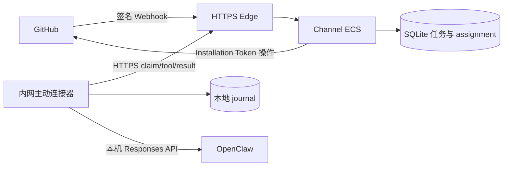

# GitHub Agent Channel 架构

## 网络方向与职责

Channel 是 Runtime 无关的 GitHub 协作入口；OpenClaw 是第一个本地Runtime适配器。云端不持有OpenClaw地址或模型token，不主动连接内网，不需要隧道或入站端口。

## 边界

- **HTTPS Edge**：复用Nginx/云网关或选用独立Caddy。转发Webhook与带认证的connector协议，不开放管理接口。
- **Webhook/Ingestion**：先验签原始body再解析；固定installation/repository/actor上下文；持久化和去重后返回202。
- **PullCoordinator**：给已认证连接器原子分配任务，校验调用者权限，产生限时lease capability。处理受控工具请求和幂等结果提交。
- **GitHub Client/DeliveryWorker**：凭据不出ECS；每次工具和回帖重新授权。回帖结果不明时停在unknown，不盲目重发。
- **内网Agent**：只出站。模型调用前写journal；模型工具请求回到ECS授权执行；结果持久化后提交。没有GitHub写凭据。
- **RuntimeConnector**：隔离OpenClaw Responses协议、工具续调用、超时和结果语义；未来Runtime实现复用任务通道。

## 持久性与执行保证

任务、assignment、lease摘要、结果摘要写入云SQLite。claim响应丢失不会重复分配执行；结果重试只有相同内容得到幂等确认，冲突拒绝。任务执行状态与回帖状态分开。

内网journal使用独立SQLite排他锁防止同一状态文件被多个进程执行。崩溃后OS释放锁；重启遇到running只回报unknown。网络断开不能证明远端停止，因此不自动再次执行模型。

云端期限过期、重启或本地报告不确定时将任务置unknown，阻塞binding和连接器。确认执行停止后管理员可终止该任务；下一次执行来自新的评论。没有“恰好执行一次”的承诺。

## 配置与部署

云端YAML包含GitHub App身份、绑定、connector身份与Edge模式。内网YAML包含Channel URL、共享connector token、仅本地使用的Runtime信息、持久journal位置。secret为文件或环境引用，生成配置不含值。

部署生成器把业务配置转成Compose/挂载/Edge路由。Cloud与Agent独立启动升级，不重复部署既有OpenClaw。数据库分别使用持久卷；同projectName升级按停止/备份/启动流程操作。参见[运维说明](operations.md)。

## 当前范围与扩展

当前单云实例、单可信connector身份；该身份处理实例内明确enabled的仓库bindings。多租户、按仓库绑定多个worker、自动续租/恢复运行中的模型以及写仓功能未开放。不能把一个实例共享token当成多租户权限方案。

当前工具read_issue/read_file和评论回写。Skills与模型编排属于Runtime；服务端授权不能依赖模型或提示词。新增写能力须实现独立Policy与受控执行，再验证冲突、越权和副作用状态。

已有社区实现对照保留在[community-reuse.md](community-reuse.md)；旧direct模式相关文档是历史记录，不作为当前部署入口。
