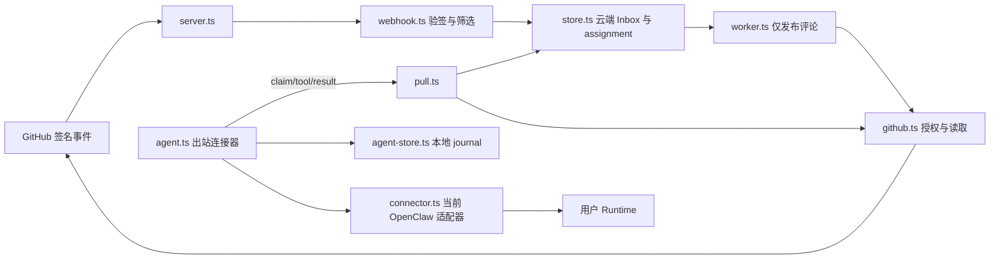

# 仓库实现地图

状态：当前实现审计。核对日期 2026-11-22，代码基线 `4a0540c`，`codex/outbound-connector`。覆盖 19 个生产 TypeScript 模块、3 个冒烟脚本、18 个测试文件，以及构建、部署和文档入口。不是将来设计，不代表逐行形式化证明或全部生产场景已验证。

产品定位见 [文档索引](README.md)；逐项功能与证据见 [能力台账](capabilities.md)。**通用 Channel 是产品目标；当前 CLI 只接入 OpenClaw，执行能力只到分析回帖。**

## 实际运行链

1. `main.ts` 在服务端加载配置/secret，恢复 SQLite 状态，装配 HTTP、PullCoordinator、DeliveryWorker；不创建 RuntimeConnector。
2. Webhook 验签后，仅符合 binding 和 @mention 条件的 `issue_comment.created` 转为任务；持久化后返回 202。actor 权限不在 ACK 前完成，而在 claim/工具/发布阶段检查。
3. `agent run` 在用户执行环境主动 claim。服务端先保存 assignment，再检查发起人权限，然后返回 task/lease；失败不会把任务内容披露给连接器。
4. 连接器保存本地 running journal，再调用 Runtime。当前工厂固定创建 `OpenClawConnector`，通过 Responses 的客户端工具续调用访问服务端读取能力。
5. 本地先保存结果，再回传；服务端原子保存结果和摘要。重复同内容确认不重跑模型，冲突返回 409。
6. 云端每 500ms 检查超时并尝试发布已完成结果；发布前重查权限，成功写入 commentUrl 与独立 deliveryStatus。

## 生产模块逐项对照

| 模块                                      | 实际职责                                                                                 | 不能从名称推断的能力                                                            | 主要验证入口                       |
| ----------------------------------------- | ---------------------------------------------------------------------------------------- | ------------------------------------------------------------------------------- | ---------------------------------- |
| [main.ts](../src/main.ts)                 | 服务端组合入口、启动恢复、500ms 投递/过期轮询、关停                                      | 不直连 Runtime；不是编码 worker                                                 | server/pull/worker 及冒烟          |
| [server.ts](../src/server.ts)             | Webhook、health、私有任务查询/人工对账；先交 coordinator 处理 connector 路径             | 无设置管理、任务列表或 Runtime 取消 API                                         | server.test.ts                     |
| [webhook.ts](../src/webhook.ts)           | 原始 UTF-8 bytes 验签、delivery UUID、事件/人类身份/仓库/提及筛选                        | 不处理 issues/push/PR review；不执行 actor API 授权                             | webhook.test.ts                    |
| [contracts.ts](../src/contracts.ts)       | Task、配置、RuntimeConnector、GitHubClient 接口                                          | Task 必需 commentId/issueNumber；结果是文本；无通用 artifact/run handle         | 关联全部模块                       |
| [config.ts](../src/config.ts)             | 云端严格 schema、唯一 binding、secret 引用、配置快照/原子更新方法                        | `update()` 未接入生产热更新；公开配置仍含 secret 引用路径，不能当作任意公开接口 | config/secrets.test.ts             |
| [secrets.ts](../src/secrets.ts)           | Env/File 互斥、文件相对 config 路径、token trim、PEM 原样                                | 不生成/轮换 App key，不同步 GitHub 设置                                         | secrets.test.ts                    |
| [store.ts](../src/store.ts)               | tasks/deliveries/assignments、事务领取、去重、租约、结果/投递状态、人工终结              | 不存代码产物、运行事件或 PR；`claim()` 非当前生产领取入口                       | store/pull-store.test.ts           |
| [pull.ts](../src/pull.ts)                 | connector Bearer、lease、claim/tool/result、严格参数、actor 授权                         | 两个工具枚举；无 capability negotiation、heartbeat/续租或多 worker 路由         | pull/outbound-e2e.test.ts          |
| [github.ts](../src/github.ts)             | Octokit App，仓库范围 token，actor 身份/角色复核，读 Issue/默认分支文件，marker 评论发布 | contents 仅 read；没有分支/commit/PR；readIssue 不含完整讨论历史                | github.test.ts                     |
| [worker.ts](../src/worker.ts)             | DeliveryWorker 领取 pending publication、授权、评论发布                                  | 不领取 queued 模型任务；不做代码执行                                            | worker.test.ts                     |
| [agent-config.ts](../src/agent-config.ts) | 内网配置、origin、token 引用、绝对 stateFile、deployment schema                          | 无 provider selector；当前 runtime 字段按 OpenClaw 使用                         | agent-config.test.ts               |
| [agent-store.ts](../src/agent-store.ts)   | journal、单进程 SQLite 文件锁、未 ACK 结果、重启 unknown                                 | 不恢复模型会话，不重新执行 running 任务                                         | agent-store/agent.test.ts          |
| [agent.ts](../src/agent.ts)               | 出站传输、claim 校验、本地落盘、调用 RuntimeConnector、结果确认/有界退避                 | `Agent` 可注入接口，但 `runAgent()` 固定 OpenClaw；不是文件编辑/命令执行引擎    | agent/outbound-e2e.test.ts         |
| [connector.ts](../src/connector.ts)       | OpenClaw Responses、session key、previous_response_id、多轮两工具、超时分类              | 不是通用协议；固定分析 prompt，无异步 run 查询/取消/编码工具                    | connector.test.ts                  |
| [cli.ts](../src/cli.ts)                   | cloud/agent init/check/render/lifecycle，agent run                                       | 不安装 OpenClaw、不安装 App、不管理事件订阅                                     | cli.test.ts                        |
| [examples.ts](../src/examples.ts)         | 两份 CLI init 模板字符串                                                                 | 不读取 deploy 目录的 YAML；存在需要同步维护的副本                               | CLI 与示例一致性检查               |
| [deploy.ts](../src/deploy.ts)             | 云端 Compose、secret 引用、可选 Caddy、Nginx 片段、bundle 防覆盖                         | 不替用户修改共享 Nginx、不创建云主机/DNS/App                                    | deploy.test.ts、Docker smoke       |
| [agent-deploy.ts](../src/agent-deploy.ts) | 出站连接器 Compose、无 ports、已有 Runtime 网络、独立持久卷                              | 不部署 Runtime 或提供代码 sandbox                                               | agent-deploy.test.ts、Docker smoke |
| [lifecycle.ts](../src/lifecycle.ts)       | 检查 Compose 2.20+、up/down/ps、离线 doctor                                              | doctor 不访问 GitHub/模型，down 不删卷                                          | lifecycle.test.ts                  |

测试名称均对应 [tests](../tests) 下的文件。运行入口和依赖以 [package.json](../package.json) 为准；`npm run channel` 用 tsx 执行源码，`npm start` 只运行编译后的云端 main。

## 状态和授权的实际边界

| 边界              | 当前实现                                                                 | 误读风险                                             |
| ----------------- | ------------------------------------------------------------------------ | ---------------------------------------------------- |
| Webhook→任务      | 验签、匹配 binding、去重后落盘                                           | 202 不是 actor 已获执行授权，也不是任务完成          |
| claim→执行        | 单 worker 原子领取，服务端 actor 授权，再返回 lease                      | 204 可能是无任务/被拒绝任务已跳过；不是执行成功      |
| 工具请求          | 从数据库恢复 scope，严格 args，lease 有效，每次授权                      | 模型不能选 owner/repo/actor；开放新工具需单独 policy |
| 执行完成→发布     | status 与 deliveryStatus 两套状态                                        | succeeded 不等于回帖送达，更不等于 PR 完成           |
| 云端重启/租约过期 | running→unknown；sending→unknown                                         | 不证明 Runtime 已停止，不允许自动再执行              |
| 本地重启          | journal running→pending unknown；已保存结果仅重传                        | 不能删 journal 来“修复重试”                          |
| 调度范围          | 一个 connector 身份，running/unknown 阻塞该 worker；binding 另有投递阻塞 | 不是多租户或跨仓并发执行器                           |
| 管理对账          | HTTP 执行对账只允许 confirmedStopped + failed；投递对账为 sent/failed    | store 内部有更宽方法，不代表 HTTP 开放了同等能力     |

## 配置、构建与部署

| 入口                                                                                                     | 事实                                                                                            |
| -------------------------------------------------------------------------------------------------------- | ----------------------------------------------------------------------------------------------- |
| [云端 YAML](../deploy/channel.example.yaml)                                                              | GitHub App、bindings、connector；无 runtime 配置。App 安装所有仓库不等于启用全部 binding        |
| [连接器 YAML](../deploy/agent.example.yaml)                                                              | Channel origin/token + 本机 Runtime origin/token + journal；不接受 GitHub App 私钥              |
| 路径解析                                                                                                 | secret File 和 agent stateFile 相对配置文件；原生云端 dataFile 相对 cwd；容器生成器固定 `/data` |
| [OpenClaw 完整模板](../deploy/openclaw.example.json) / [合并片段](../deploy/openclaw.channel.patch.json) | 当前读取/回帖实验配置；deny 内置工具，不是产品永远不能执行代码的规则                            |
| [Dockerfile](../Dockerfile)                                                                              | Node24 多阶段构建，UID1000；镜像默认运行云端，agent Compose 覆盖 command                        |
| [.dockerignore](../.dockerignore)                                                                        | 构建上下文白名单；脚本、文档、用户配置与 secret 不进入镜像                                      |
| HTTPS                                                                                                    | 服务端 HTTP 位于已有 edge 或可选 Caddy 后；ECS 只是自建部署示例                                 |
| 公网路由                                                                                                 | Webhook 和 connector 协议；管理 `/tasks/*` 与 `/healthz` 不经生成 edge 对外暴露                 |
| 更新配置                                                                                                 | 生成新 bundle、同 projectName 保留卷、按运维停止/重启；无自动热加载                             |

## 测试与证据分层

| 文件/命令                                                       | 真正运行的部分                                                        | 替身/未覆盖部分                                                |
| --------------------------------------------------------------- | --------------------------------------------------------------------- | -------------------------------------------------------------- |
| 18 个 tests 文件，`npm test`                                    | TypeScript 逻辑、SQLite、SDK 验签、部分实际本机 HTTP                  | GitHub API/模型用 fake transport/client；本轮 88 通过          |
| [smoke-deployment.mjs](../scripts/smoke-deployment.mjs)         | Docker 构建、非 root、Compose、Nginx、Caddy 本地 CA、卷、真实出站 TLS | GitHub 与模型效果为合成数据；不做公网 ACME                     |
| [smoke-fixture-server.mjs](../scripts/smoke-fixture-server.mjs) | 复用生产 HTTP/coordinator/store/DeliveryWorker                        | 替换 GitHubClient，额外写 smoke 表；仅隔离测试，不属于生产入口 |
| [smoke-openclaw.mjs](../scripts/smoke-openclaw.mjs)             | 真实模型文本与两工具续调用                                            | 工具读取合成 fixture，不访问 GitHub，不修改代码                |
| [.github/workflows/checks.yml](../.github/workflows/checks.yml) | 格式、类型、88 项测试随代码变化、build、Docker smoke                  | 未配置真实 App/模型生产凭据                                    |
| [真实主动连接记录](outbound-validation-20261122.md)             | 当时一个绑定仓库的 GitHub→Runtime→回帖、重投                          | 不是持续健康监控，不含代码→PR、多 Runtime 互操作               |

## 目标差距与调查顺序

已确认的实现差距见 [治理与偏差记录](governance-review-20261122.md)。后续先完成外部复用与架构评估，再确定能力扩展：不能因为缺少编辑/测试/PR，就默认把这些全部写进 Channel 核心；也不能因为目标是通用，就声称当前已经支持任意 Runtime。
