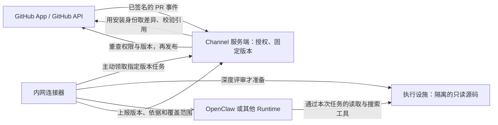

# PR 评审上下文实施方案

**目标：** 维护者只需打开或更新 PR。Agent 自动取得这次改动；声明支持深度评审的组合还能在同一版本查找改动之外的证据。依据：[产品契约 C2/C3/C6/C7/C8、W1/W3](../../product-contract.md)。下表保留设计与真实验收标准。当前代码实现了同仓版本差异、可选 OpenClaw 只读快照及正文型原生 Review；行内定位与真实 H1/H2 验收尚未完成。配置与限制见[评审指南](../../pr-review.md)。

## 实施前基线

对照 main `1e56df7`：[webhook](../../../src/webhook.ts) 从 PR 事件取标题和正文，评论事件取评论正文；[target](../../../src/outcomes.ts) 标识 PR 号，未固定被审版本。[GitHub 客户端](../../../src/github.ts) 会检查 PR 是否开放，但 read_issue 不返回差异，read_file 未带 ref。[OpenClaw 工具](../../../src/connector.ts) 不能搜源码；[ACP 工作区](../../../src/runtime-workspace.ts) 校验管理员准备的干净 clone，不负责同步 PR。已有发布器能发评论或 draft PR，不能发原生 Review。

[问题 #17](https://github.com/xallor-ai/github-agent-channel/issues/17) 跟踪真实事件；[#19](https://github.com/xallor-ai/github-agent-channel/pull/19) 处理不可读文件和失败反馈。后者使读取目录后继续分析成为可能，但不提供 PR diff。两项不能相互代验。实现之前先刷新远端基线。

## 谁准备代码，谁决定可以读什么

Channel 决定安装、仓库、PR、允许读取的版本和返回位置；Runtime 不能自行指定其他仓库。默认由执行设施在任务开始时准备 head 源码，能按需取得对照版本，不要求完整 Git 历史。3.183 是一种部署。把 repo 放进 OpenClaw 的共享 workspace 既不能证明版本正确，也不会自动给当前适配器增加搜索工具。

## 分批交付

| 顺序 | 可单独交付的行为 | 从哪里改，复用什么 | 合格证据 |
| --- | --- | --- | --- |
| 1 · 先做版本化差异（C3/W1） | PR 事件保留来源版本；评论委派在首次获授权解析 PR 时固定 base/head 及双方仓库身份。按 GitHub PR 比较语义取变更、补读指定版本的文件。 | 从 webhook、contracts/outcomes、store、pull、github、connector 入手；复用 Octokit 的 [固定 SHA Compare](https://docs.github.com/en/rest/commits/commits#compare-two-commits) 与 [Contents ref](https://docs.github.com/en/rest/repos/contents#get-repository-content)。长读取在入队后做；不在 Webhook 中 clone。 | 无手贴材料也能指出只在 head 存在的一行。覆盖文件上限、改名、删除、无 patch、fork 无权读取；禁止回退 main。采集前后核对同一版本，比较期间换 head 则丢弃已过时结果；领取或发布时目标变更，旧任务不得评新 head。 |
| 2 · 只读整仓分析（C2/C3/C7） | 支持深评的组合在拿到步骤 1 的任务后，准备隔离源码，让模型确实能查找并打开未改动文件。 | 连接器协调现成 Git/指定 SHA 的源码归档及已有隔离设施；OpenClaw 适配器提供受任务约束的搜索和读取。复用已有身份、租约、路径与版本校验；不要把 ACP 的可写 clone 当作共享目录。 | 两个任务并发读不同版本不串线；能引用未改文件的路径和位置。拒绝跨仓、越界和撤权后的新读取；模型拿不到 App 私钥或下载凭据。成功、失败、超时及重启后均有快照清理路径。 |
| 3 · 原生发布（C6/C7/W3） | 对具体 commit 发布 GitHub Review，并在原任务关联回执。普通分析评论继续按 W1 计。 | 扩展 outcomes、github、worker 与对账接口；复用 Octokit [Reviews API](https://docs.github.com/en/rest/pulls/reviews)。核验 installation、actor、绑定、开放状态、版本及行定位；沿用未知写入先对账的规则。 | GitHub 上存在该 commit 的 Review ID/URL；行定位失效不猜位置，说明未发布项。head 在发布前推进时不把旧结论发给新版本；发布响应丢失不重复写。 |

**步骤 1 的首个回归：** 在 [webhook 测试](../../../tests/webhook.test.ts) 构造 opened(H1) 与 synchronize(H2)，保留两份事件身份；在 [GitHub 客户端测试](../../../tests/github.test.ts) 让默认分支与 H1/H2 的同一路径返回不同内容，并在读取固定 SHA 比较结果期间推进 head；在 [HTTP 端到端测试](../../../tests/outbound-e2e.test.ts) 断言成功回执只指向实际检查的版本。数据结构变更须明确协议/存储版本；不新增旧字段别名，不静默迁移旧库。技术方案通过后再实施。

**步骤 2 的首个部署选择：** 优先验证“连接器取得仅限本任务的源码 → 独立目录只读挂载或由受限读取工具访问 → 任务结束回收”。先不做常驻镜像、全仓索引或自动运行测试。若下载和搜索成为实测瓶颈，再引入按授权仓库隔离的 Git 对象缓存；缓存命中仍须核对授权和 SHA。编码、依赖安装及运行仓库测试属于单独授权的执行环境。

## 真实验收：一个 PR、两次提交

- [ ] 准备测试仓库：H1 改动一处函数，保留一个**未改动**的调用方或测试；不给机器人 diff、文件名或答案。通过真实 `opened` 触发，记录投递、任务、base/head、运行、材料范围与回执。
- [ ] 只声明差异评审的组合须指出 H1 的具体改动；声明深评的组合还须自行找到未改文件并解释关联性。分别核对仓库内容。说“测试通过”必须有独立执行证据。
- [ ] 在同一 PR 推送可区分的 H2，通过真实 `synchronize` 复核；让 H1 的一个测试运行迟到，确认它无法替 H2 发布通过。单独模拟文件数与字节限制造成的截断、关闭或撤权，验证提示与拒绝行为。
- [ ] 从原线程核对 H1/H2 各自的版本与 GitHub 实际回执。收到评论只登记 W1；收到原生 Review 才登记 W3。按运行时与执行设施组合更新[能力台账](../../capabilities.md)，不把本地夹具计为真实验收。
