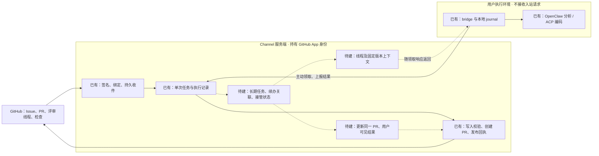

# 从产品契约到目标架构

**设计基线：`9c6b3b1`。** [运行中的 v2 架构](architecture.md)描述今天怎么工作；本图描述怎样在现有边界上实现[产品契约](product-contract.md)。节点代表职责，不要求拆成独立服务。

实线是现有路径，虚线是拟增协作。TLS 可复用已有入口或独立部署；不因续办而暴露内网 Runtime。GitHub 写入仍集中在服务端。图中的「更新」必须扩展发布器的正式操作，不能复用「创建 PR」并猜测其含义。

| 边界 | 保留 | 下一步设计与责任 |
| --- | --- | --- |
| 接入与路由（C1–C3） | 安装、仓库、actor 校验，按配置启用事件 | 接收明确面向 Agent 的行内请求；在线诊断区分未订阅、投递失败、无能力与离线。对未启用操作不派发 |
| 任务控制（C4–C5） | delivery 去重、单次 assignment、lease、journal | 服务端保留稳定工作身份、已确认范围、原 Issue、关联 PR/线程和历次运行。新事件可以开启新工作，也可明确续办；歧义时等待澄清 |
| 执行（C2、C5、C8） | 显式选择 adapter；编码及模型工具交给已有 harness | 在执行前匹配仓库所选组合和意图；选不出则说明原因。第一条完整 W2 可固定为一个已配置的编码组合，无需先建设多 worker 调度 |
| 发布与核验（C6–C7） | 独立收集变更、验证、授权和回执 | 区分首次创建和续改；将每轮提交、验证对象与写入回执关联到原任务。旧运行失去写资格后不再发布 |
| GitHub 用户界面（W1–W4） | Issue/PR 评论、draft PR | 原任务给出当前状态与成果链接；行内反馈留在原线程。Review、Check、普通评论分别呈现，不互相冒充 |

**不可混用的标识：** 投递标识回答“这一事件收过吗”；工作身份回答“用户在续办哪项委派”；执行标识回答“哪一次尝试”；Runtime session 只描述执行器会话；PR head SHA 回答“哪份代码被验证”。一次工作可以有多次执行，一条 PR 也可以关联多项工作。安装、仓库或线程改变时不能仅凭编号归并。

**演进边界：** 新工作模型、持久化字段和更新操作属于待设计接口，不是现有 v2 API。实现前决定是否需切换协议和状态库；若不兼容，明确拒绝旧格式并保留原数据，不建别名或迁移路径。模块入口见[实现地图](implementation-map.md)，实施顺序见[交付计划](contract-delivery.md)。
