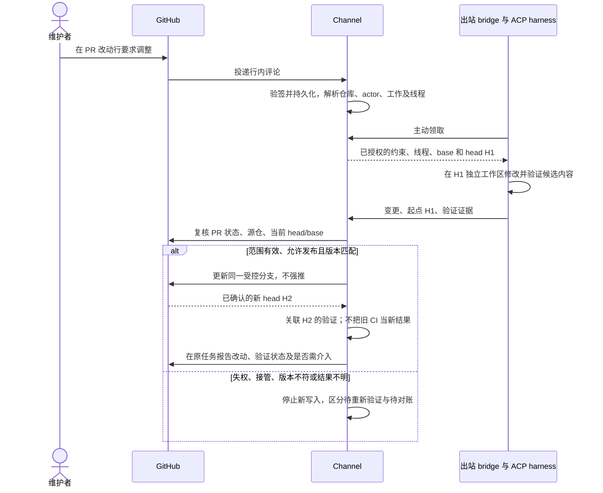

# W2 详细设计：在同一 PR 上完成第二轮修改

**目标，尚未验收。** [历史实测](acp-live-validation-20261124.md)已覆盖 Issue → 实际编码与验证 → draft PR。当前发布器创建 `channel/<task.id>`；发现分支已存在即拒绝。它不会更新已有 PR。下面从现有 PR 的第二轮请求开始，整张时序图均为目标行为。

| 决策点 | 输入与处理规则 | 用户可核验的结果 |
| --- | --- | --- |
| 这是续办还是新工作？（C2/C4） | 优先使用服务端保存的 PR 发布回执、线程关联和明确的任务引用。当前 actor 仍须有权委派。无匹配或多项匹配时要求选择，不能按 PR 编号随意挑一个 | 在原 Issue 找到第二轮请求；同一 PR 的另一任务未被修改 |
| 改哪一版？（C3/W2） | 服务端读取同仓受控 PR 的源/目标仓库、分支、head/base、行锚点及有界 diff；来自 fork 的代码和评论只作为数据。已关闭、未授权或锚点过期时不给写任务；过期位置须重新定位或澄清 | 维护者不手贴 diff；记录准确文件、版本、材料缺失或截断 |
| 如何准备下一轮？（C4/C8） | 领取后使用与 H1 一致的干净独立 clone。工作区生命周期交给执行设施；不得重置第一轮脏目录。若设施不能连续提供合格环境，阻止执行并报告；该组合不能宣称完整支持 W2 | 无需运维手切 Runtime 或手工清理工作区 |
| 如何保护人类提交？（C7/W2） | 已有人类新提交则从最新 head 生成增量。发布前再核对 head、base、actor、允许路径、任务写资格和验证对象；只允许不会丢提交的分支更新。读取与写入之间的竞态也须拒绝非快进覆盖。base 推进则重评集成条件，不能盲用旧验证 | 安全时保留人类提交、PR 编号不变；无法安全接续时保留成果并解释冲突 |
| 接管或丢响应怎么办？（C5/C7） | 冻结旧运行发布；隔离旧工作区或取得可核验停止证据后才交给人使用。仅发出 ACP cancel 不算停止。在途写入用 PR/ref 和预期提交对账，不重跑模型或盲重发。重新委派产生新执行，重新校验范围 | 明确显示停止中、已停止或未知，以及哪些改动可取回 |
| 何时算完成？（C6/W4） | 预发布验证须绑定候选内容，发布回执另存。确认 H2 后取得针对 H2 的必需验证结果（精确提交上的独立验证或匹配 SHA 的 CI）。本地通过、已发布、CI 等待、任务完成分开报告 | 原 Issue 可见 PR、H2、验证链接或报告、失败原因和下一步；未满足约定不报完成 |

首轮仅设计**同仓、由 Channel 创建、仍开放的受控 PR**续改。更新第三方分支、自动合并、fork 跨仓写入不在这一交付内。通过 W2 也不等于具备 W3 原生 Review。工作区隔离与分支并发控制必须在写入功能启用前验证。
